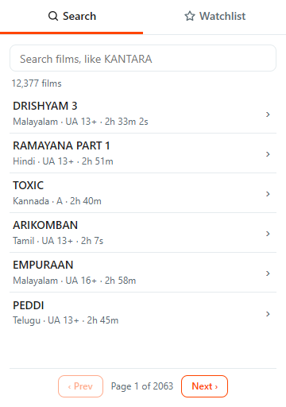
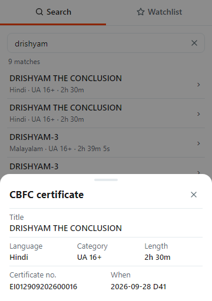
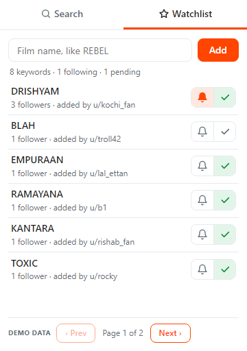

# CBFC Tracker

Reddit (Devvit) app for following Indian CBFC film certificates. Built for [r/kerala_boxoffice](https://www.reddit.com/r/kerala_boxoffice/); works in any subreddit.

| Search                                                                                | Certificate                                                                                     | Watchlist                                                                                   |
| ------------------------------------------------------------------------------------- | ----------------------------------------------------------------------------------------------- | ------------------------------------------------------------------------------------------- |
|  |  |  |

- **Search:** every stored film, newest first; tap a row for its certificate.
- **Watchlist** (demo data for now): follow a one-word keyword (2–20 letters/digits, max 3 per user) and see "N new" certificates since you followed. Mods approve keywords.

## Install (moderators)

1. Install from [developers.reddit.com/apps/cbfc-tracker](https://developers.reddit.com/apps/cbfc-tracker).
2. Set the app settings (below).
3. Mod menu → **Add CBFC Tracker** creates the post.

| Setting             | Purpose                                                                                                      |
| ------------------- | ------------------------------------------------------------------------------------------------------------ |
| Title               | Title of the tracker post                                                                                    |
| Source post ID      | Post (e.g. `1abc2de`) with a `\| Title \| Language \| Category \| Length \| Ref \| When \|` table. Optional. |
| Initial data (JSON) | One-time import of older certificates, imported on save; clear after.                                        |

The source post is read:

- when it is edited (instantly)
- when the Source post ID is saved
- when someone opens the tracker (at most every 15 min, catches missed edits)
- hourly, as a last fallback

Initial data is a JSON list:

```json
[
  {
    "category": "UA 13+",
    "date": "2026-11-08",
    "language": "Tamil",
    "length": "2h 7s",
    "ref": "CHE/1/210/2026",
    "title": "ARIKOMBAN"
  }
]
```

Only films (≥ 1 hour, not future-dated) are kept; certificates are deduplicated by `ref`.

## Develop

Node ≥ 24 and Reddit Developer Platform access.

```bash
npm install && npx devvit login
npm test          # types, lint, unit tests, build
npm run playtest  # live on r/cbfc_tracker_dev
npm run upload    # publish a new version
```

`src/client` page code · `src/server` app server (`certs.ts` parses, `store.ts` stores in Redis) · `src/shared/api.ts` shared types · `public/index.html` page.
